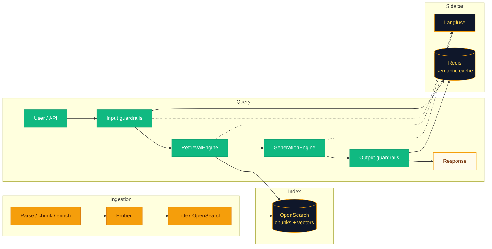
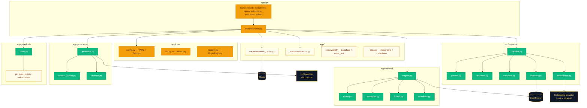

<p align="center">
  
</p>

<h1 align="center">Enterprise RAG System</h1>

<p align="center">
  <em>Your documents deserve better than Ctrl+F.</em>
</p>

<p align="center">
  <a href="https://www.python.org/downloads/"></a>
  <a href="https://react.dev/"></a>
  <a href="https://www.llamaindex.ai/"></a>
  <a href="https://opensearch.org/"></a>
  <a href="https://langfuse.com/"></a>
  <a href="https://docs.docker.com/compose/"></a>
</p>

<p align="center">
  Production-oriented <strong>Retrieval-Augmented Generation</strong> for teams that want <strong>hybrid search</strong> (dense vectors + BM25), <strong>configurable guardrails</strong>, <strong>semantic caching</strong>, <strong>RAG-style evaluation</strong>, and <strong>Langfuse-ready observability</strong>—without pretending a single vector database solves enterprise search.
  <br /><br />
  <strong>FastAPI</strong> backend · <strong>React 18 / Vite / Tailwind</strong> SPA
</p>


---


## Why this exists

Real knowledge bases are messy. People ask with jargon one day and plain language the next. Some questions need semantic similarity; others need exact policy numbers and product SKUs. A RAG stack that only does kNN will miss the obvious keyword hit; a stack that only does BM25 will miss paraphrases.

This repo is a **reference implementation** you can run, extend, and argue with: documents flow through a **YAML-driven ingestion pipeline** (parser → chunker → enrich → embed → index) into **OpenSearch** with both **`knn_vector`** and analyzed **`text`**. At query time, a **retrieval engine** routes the question, runs one or more retriever strategies, **fuses** ranked lists (**RRF** or weighted sum), **reranks** with a cross-encoder, and hands a **token-budgeted context** to the LLM. **Guardrails** sit on both sides of that path; **Redis** backs an **embedding-similarity semantic cache**. Configuration stays **declarative** in `config.yaml`; secrets live in **`.env`**.

> [!TIP]
> If you are deciding whether to clone this: skim the Mermaid diagrams below, then jump to **Your first ten minutes**—you will know in one coffee whether the architecture matches how you think about RAG.

---

## What makes this different

**Hybrid retrieval, for real.** Dense kNN on `knn_vector` plus lexical `match` on `text`, fused with **RRF** or weighted sum, then **cross-encoder reranking**—so you are not betting the farm on a single scoring regime.

**Guardrails that behave like policy, not vibes.** Ordered **input** and **output** chains: PII, topics, toxicity, and an NLI-style **hallucination check** against retrieved chunks. Each step returns a shared **`GuardrailResult`** (`block` / `warn` / `redact`).

**Observability you can actually ship.** **Langfuse** client plus a small **`@trace_span`** decorator; an **EventBus** publishes lightweight in-process query lifecycle events when you want to wire your own analytics.

**Plugins, not a monolith.** `PluginRegistry` + YAML names keep **ingestion** and **retrieval** swappable: **parser → chunker → enrich → embed → index** and **router → strategies → fusion → reranker**.

**Evaluation that speaks RAG.** **RAGAS-inspired** metrics (**faithfulness**, **answer_relevance**, **context_precision**, **context_recall**) via the configured LLM, plus an offline **SQuAD-derived pilot** and a written 40-response evaluation report. See [Evaluation](#evaluation).

---

## How the pieces breathe together

End-to-end flow from ingestion through response, with policy and telemetry hooks:



---

## Under the hood (modules)

How packages under `backend/app/` interact at runtime (simplified, but faithful):



---

## Why the design landed this way (short stories)

**OpenSearch for hybrid search.** Many enterprises already run OpenSearch (or its lineage) for logs and search. One index can hold **`knn_vector`** on `embedding` and **analyzed** `text` for BM25-style sparse retrieval; the router can also select a **`hybrid`** strategy. That is fewer moving parts than “vector DB for semantics + something else for keywords.”

**Langfuse for tracing.** Managed trace UI, solid SDK, and a thin **`trace_span`** decorator mean you extend spans on hot paths without building a bespoke trace store first. If you outgrow it, OpenTelemetry exporters can ride alongside.

**Plugin registries everywhere.** `PluginRegistry` maps string names to parsers, chunkers, embedders, indexers, routers, retrievers, fusion, rerankers. YAML picks plugins and passes opaque `*_params`—so new behavior lands as **register + name**, not as another branch in `main.py`.

**Guardrails as ordered chains.** Sequential plugins with **`GuardrailResult`** mirror how policy engines and DLP pipelines tend to compose: predictable order, explicit actions, and HTTP **`400`** when something is **`blocked`**.

**Redis semantic cache.** Store query embedding + payload; on lookup, **cosine similarity** against cached entries above **`similarity_threshold`** (`0.9` in the shipped `config.yaml`). Trade-off: the implementation **scans** keys under `semcache:*`—simple, but **O(n)** in cache size. High-traffic production often graduates to Redis Stack ANN or a dedicated cache index.

**RAGAS-style evaluation without importing `ragas` at runtime.** **`EvaluationEngine`** implements **faithfulness**, **answer_relevance**, **context_precision**, **context_recall** with short LLM prompts returning one numeric score—fewer dependencies, same vocabulary teams already use. Scores are **judge-dependent**; calibrate for your domain.

> [!IMPORTANT]
> **`GET /admin/config`** returns the full active YAML-derived configuration as JSON. Treat it like a loaded gun in production: put it behind auth and network policy.

---

## Where this shines (use cases)

1. **Enterprise knowledge base Q&A** — Ingest PDFs and policies; hybrid search catches paraphrases and keyword-heavy questions alike.
2. **Document-grounded customer support** — Product docs in the index; answers cite **`[1]`**, **`[2]`**; PII can be redacted on the way in.
3. **Compliance-aware retrieval** — Collections partition data; topic allow-lists and output toxicity / entailment checks reduce risky replies.
4. **Multi-tenant RAG service** — Per-tenant **`collection_id`** on upload and query filters OpenSearch with **`term`** on **`collection_id`**.

Deeper walkthroughs: [wiki/Use-Cases.md](wiki/Use-Cases.md).

---

## Your first ten minutes

Commands below run from the repository root unless stated otherwise. The backend reads `config.yaml` and `.env` relative to the directory you start it from, so always start it from the root.

### 0) What you need

- **Python 3.12**, **Node.js 22** (matches the frontend Dockerfile), and **Docker** for OpenSearch and Redis (or point `OPENSEARCH_URL` / `REDIS_URL` at clusters you already run)
- An LLM and embedding source. Pick one:
  - **Local (what the checked-in `config.yaml` uses):** [Ollama](https://ollama.com) running with `ollama pull qwen2.5:1.5b`. Embeddings use `all-MiniLM-L6-v2` on your machine; no API key is needed.
  - **OpenAI:** an `OPENAI_API_KEY`, plus the `llm` and `ingestion.embedder` settings changed in `config.yaml` (see [Configuration](#configuration-the-guided-tour)).

### 1) Clone and wire secrets

```bash
git clone https://github.com/RakeenHarmainKhan/Enterprise-RAG.git
cd Enterprise-RAG
cp env.example .env          # PowerShell: Copy-Item env.example .env
```

Edit `.env` as needed. Leave optional values blank to use the defaults. Set `OPENAI_API_KEY` only if you use OpenAI.

### 2) Install dependencies

```bash
py -3.12 -m venv rag-env                    # or: python3.12 -m venv rag-env
rag-env\Scripts\activate                    # macOS/Linux: source rag-env/bin/activate
pip install -r backend/requirements.txt     # pulls PyTorch via sentence-transformers; the first install is large

cd frontend && npm install && cd ..
```

The `rag-env` name matches the evaluation scripts below and is ignored by Git.

### 3) Start OpenSearch and Redis

```bash
docker compose --profile cache up -d
```

This starts OpenSearch on `127.0.0.1:9200` and Redis on `127.0.0.1:6379`. Readiness checks both, so include the `cache` profile. Without it, only OpenSearch starts.

### 4) Run the API and UI

```bash
uvicorn app.main:app --app-dir backend --reload --port 8000
```

In a second terminal:

```bash
cd frontend && npm run dev
```

> [!NOTE]
> Using a local model? Start Ollama first (`ollama serve`, if it is not already running) and confirm the model is pulled.

### 5) What “healthy” looks like

- **API:** http://localhost:8000, OpenAPI docs at http://localhost:8000/docs
- **UI:** http://localhost:5173

```bash
curl http://localhost:8000/health/live
curl http://localhost:8000/health/ready
```

Example **`/health/live`**:

```json
{ "status": "ok" }
```

Example **`/health/ready`** (both dependencies up):

```json
{
  "ready": true,
  "components": {
    "opensearch": { "ping": true },
    "redis": { "ping": true }
  }
}
```

> [!TIP]
> When retrieval feels “mysterious,” list the indices with `curl http://127.0.0.1:9200/_cat/indices?v` and inspect the chunk index named in **`ingestion.indexer_params.index_name`** (`enterprise_rag_local_minilm_chunks` in the shipped config).

---

## Docker services

`docker-compose.yml` runs the local infrastructure only:

| Service | Image | Host port | Profile |
|---------|-------|-----------|---------|
| `opensearch` | `opensearchproject/opensearch:2.19.7` (single node) | `127.0.0.1:9200` | default |
| `redis` | `redis:7-alpine` (append-only) | `127.0.0.1:6379` | `cache` |

The compose file header says the API and UI are meant to run on the host, not in containers. `backend/Dockerfile` and `frontend/Dockerfile` exist, but `docker-compose.yml` does not reference them. If you containerize the backend, name the service `backend`: the frontend's nginx config proxies `/api/` to `http://backend:8000`.

> [!WARNING]
> OpenSearch here uses **`DISABLE_SECURITY_PLUGIN=true`** for local ergonomics. Ports are bound to loopback only. **Do not** expose this posture beyond your machine; enable security, TLS, and fine-grained access control for any shared cluster.

---

## Project layout

```text
Enterprise-RAG/
├── config.yaml                 # Declarative plugins, retrieval, guardrails, evaluation
├── env.example                 # Environment template (copy to .env)
├── docker-compose.yml          # OpenSearch (+ Redis under the "cache" profile)
├── report.md                   # 40-response evaluation report (4,000-token budget)
├── LICENSE
├── README.md
├── docs/assets/icon.svg        # Brand mark for README / docs
├── wiki/                       # Extended documentation (linked from here)
├── evaluation_data/            # Local SQuAD pilot and run outputs (Git-ignored, except one sample file)
├── .github/workflows/ci.yml    # Ruff + pytest on push / PR to main
├── backend/
│   ├── app/
│   │   ├── main.py             # FastAPI app, lifespan wiring
│   │   ├── state.py            # AppState dataclass
│   │   ├── api/                # routes + DI
│   │   ├── cache/              # semantic_cache (Redis)
│   │   ├── core/               # config, llm, registry, logging, exceptions
│   │   ├── evaluation/         # RAGAS-style metrics
│   │   ├── generation/         # context_builder, generator, citations
│   │   ├── guardrails/         # chain + plugins
│   │   ├── ingestion/          # pipeline, parsers, chunkers, embedders, indexers, enrichers
│   │   ├── observability/      # Langfuse, event_bus
│   │   ├── retrieval/          # engine, router, strategies, fusion, rerankers
│   │   └── storage/            # document + collection JSON stores
│   ├── scripts/                # SQuAD pilot preparation and baseline runner
│   ├── tests/                  # pytest suite
│   ├── Dockerfile
│   ├── pytest.ini
│   └── requirements.txt
└── frontend/
    └── src/
        ├── App.tsx
        ├── components/
        │   ├── ChatInterface.tsx
        │   ├── DocumentManager.tsx
        │   ├── AnalyticsDashboard.tsx
        │   ├── GuardrailsConfig.tsx
        │   └── EvaluationPanel.tsx
        ├── services/api.ts
        └── store/index.ts
```

---

## Configuration (the guided tour)

The checked-in `config.yaml` is a **local laptop profile**: Ollama LLM (`qwen2.5:1.5b`), local MiniLM embeddings (384 dimensions), recursive chunking, and a cross-encoder reranker. Changing the embedding model changes the vector dimension, so re-index into a new `index_name` rather than reusing the existing one.

### Ingestion (`config.yaml` → `ingestion`)

- **`parser`** — Default plugin; **overridden by file extension** (`.pdf` → `pdf`, `.docx` → `docx`, `.html` → `html`, `.md` → `markdown`)
- **`chunker`** — `fixed`, `recursive` (LlamaIndex **`SentenceSplitter`**), or `semantic` (embedding similarity between sentences)
- **`embedder`** — `openai` or `local` (sentence-transformers)
- **`indexer`** — `opensearch` — **`indexer_params.index_name`** names the chunk index
- **`*_params`** — Passed into plugin constructors / calls (chunk size, overlap, embedding model, batch size)

### Retrieval (`retrieval`)

- **`router`** — `hybrid` (always hybrid), `rules` (heuristic), `classifier` (LLM token: dense/sparse/hybrid — requires LLM in lifespan)
- **`strategies`** — List of `{ name, weight, params }` — `dense`, `sparse`, `hybrid_strategy` retrievers
- **`fusion`** — `rrf` (reciprocal rank) or `weighted_sum`
- **`fusion_params`** — e.g. RRF **`k`**
- **`reranker`** — `cross_encoder` or `passthrough`
- **`reranker_params`** — Model name, **`top_k`**

### Guardrails (`guardrails`)

- **`input_chain`** — Typical plugins: **`pii_detector`**, **`topic_filter`**
- **`output_chain`** — Typical plugins: **`toxicity_filter`**, **`hallucination_checker`**

Each step: **`plugin`** + **`params`** (e.g. **`action`**: `redact` | `block` | `warn`, thresholds, **`allowed_topics`**).

### Cache and observability (`cache`, `observability`)

- **`cache.backend`** — `redis`; **`ttl_seconds`** and **`similarity_threshold`** (`0.9` shipped)
- **`observability.langfuse_enabled`** and **`tracing`** — Langfuse needs `LANGFUSE_*` keys in `.env`

Full reference: [wiki/Configuration.md](wiki/Configuration.md).

---

## Evaluation

Evaluation has three parts: in-app metrics you can call over HTTP, an offline pilot built from SQuAD 2.0, and a written report on a 40-response run.

### In-app metrics

`EvaluationEngine` (`backend/app/evaluation/metrics.py`) scores a question, answer, and contexts with the configured LLM as a judge. Each metric asks for a single number in `[0, 1]`:

| Metric | Asks the judge |
|--------|----------------|
| `faithfulness` | Does every claim in the answer follow from the contexts? |
| `answer_relevance` | Does the answer address the question? |
| `context_precision` | Is each excerpt useful for the question? (mean over up to 5 contexts) |
| `context_recall` | Could the answer be fully derived from the contexts? |

Choose metrics under **`evaluation.metrics`** in `config.yaml`. Results are kept **in memory** and are lost on restart.

```bash
curl -sS -X POST http://localhost:8000/evaluation/run \
  -H "Content-Type: application/json" \
  -d '{
    "question": "Summarize SLA",
    "answer": "99.9% monthly uptime.",
    "contexts": ["SLA: 99.9% uptime commitment per calendar month."]
  }'
```

> [!WARNING]
> LLM judges drift with the model, temperature, and prompt. Treat scores as **comparative within one setup**, not absolute truth.

### Offline SQuAD pilot

`backend/scripts/` contains a reproducible pilot workflow that uses SQuAD 2.0 dev data. Outputs go under `evaluation_data/`, which is Git-ignored.

1. **Prepare** the pilot (downloads official SQuAD 2.0 dev data once, then reuses a validated cache):

   ```powershell
   .\rag-env\Scripts\python.exe backend\scripts\prepare_squad.py --download --output evaluation_data\squad-pilot
   ```

   The script selects 20 answerable and 10 unanswerable questions plus ten extra passages, with fixed seed `42` (override with `--seed`). Identical input and seed reproduce identical files. Use a new output directory each time; existing ones are never overwritten.

2. **Review** the cases. Place a `review.json` beside `cases.jsonl` with `schema_version: 1`, the SHA-256 of `cases.jsonl`, and one `include` / `exclude` decision per question. Unanswerable labels only apply to each original passage, so review them against the whole generated corpus before treating them as unanswerable.

3. **Run the baseline** against a running local backend (default `http://127.0.0.1:8000`):

   ```powershell
   .\rag-env\Scripts\python.exe backend\scripts\run_squad_baseline.py --dataset evaluation_data\squad-pilot --output evaluation_data\runs\baseline-1
   ```

   The runner creates an isolated collection, uploads only the corpus passages, and queries sequentially with `use_cache=false` and `stream=false`. It saves `run.json` and `results.jsonl` (responses, retrieved chunks, and timings). It refuses to overwrite an existing output folder or reuse the `squad-eval` collection name. It never retries uploads or deletes data. A successful run means the requests completed, not that the answers were correct.

Ingest only the `corpus/` passages. Questions, reference answers, and the manifest are evaluation metadata and must not be indexed. The SQuAD data is CC BY-SA 4.0; check attribution requirements before redistributing passages.

Details and failure handling: [wiki/Evaluation.md](wiki/Evaluation.md).

### Reported run

[report.md](report.md) documents a 40-response run against ten official Python 3.12 documentation pages:

- **32 answerable** and **8 challenge** cases (false premises and out-of-corpus questions)
- Four RAGAS-style metrics for the answerable cases and a behavior rubric for the challenge cases
- Retained questions, reference answers, responses, and selected contexts: [`evaluation_data/runs/python-docs-40-4000/samples.jsonl`](evaluation_data/runs/python-docs-40-4000/samples.jsonl)

---

## API at a glance

| Method | Path | Description |
|--------|------|-------------|
| GET | `/health/live` | Liveness |
| GET | `/health/ready` | Readiness — OpenSearch ping + Redis ping |
| POST | `/documents/upload` | Multipart upload; optional `collection_id` form field |
| GET | `/documents` | List document metadata |
| GET | `/documents/{doc_id}` | Single document |
| DELETE | `/documents/{doc_id}` | Delete chunks in OpenSearch + local files |
| POST | `/query` | RAG query; set `stream: true` for SSE when `generation.streaming` is true |
| POST | `/query/batch` | Up to 32 non-streaming queries |
| GET | `/collections` | List collections |
| POST | `/collections` | Create collection |
| GET | `/collections/{id}` | Get collection |
| PATCH | `/collections/{id}` | Update name/description |
| DELETE | `/collections/{id}` | Delete collection |
| POST | `/evaluation/run` | Run configured metrics on question/answer/contexts |
| GET | `/evaluation/results` | Recent in-memory evaluation rows |
| GET | `/admin/stats` | Index document count, registered docs, reindex flag |
| POST | `/admin/reindex` | Background re-ingest of `ready` documents |
| GET | `/admin/config` | Active YAML config as JSON (`model_dump`) |
| POST | `/admin/cache/clear` | Clear the semantic cache if caching is enabled |

Examples and payloads: [wiki/API-Reference.md](wiki/API-Reference.md).

---

## Security and operations (the boring page you will thank later)

- **Secrets** live in **`.env`** (never commit). **`OPENAI_API_KEY`**, OpenSearch credentials, Redis URL, and Langfuse keys are read via **`pydantic-settings`**.
- **`GET /admin/config`** exposes the full active configuration—**restrict** it behind auth / network policy in production.
- **CORS** is controlled by **`CORS_ORIGINS`** (comma-separated). Tighten for production frontends.
- **Uploads** land under **`UPLOADS_DIR`** (default **`uploads/`**); plan disk and backup for regulated data.

> [!CAUTION]
> **`DELETE /documents/{doc_id}`** removes OpenSearch chunks, registry entries, and upload directories for that document. There is no “undo” button in the API—treat deletes as destructive.

---

## Development workflow

```bash
# Backend (from backend/)
pytest                 # tests; pytest.ini sets testpaths=tests and asyncio_mode=auto
ruff check .           # lint (CI runs this on Python 3.12)
ruff format .          # format

# Frontend (from frontend/)
npm run lint           # TypeScript check
npm run build          # type check + production build
npm run format         # Prettier on src/
```

Pre-commit hooks are configured in `.pre-commit-config.yaml` (whitespace and YAML checks, debug-statement check, Ruff). Install them with `pre-commit install` if you use pre-commit.

---

## Frontend

The SPA uses **axios** against the API (`frontend/src/services/api.ts`). In development, requests go to relative paths, and the Vite dev server proxies `/health`, `/documents`, `/query`, `/collections`, `/evaluation`, and `/admin` to `http://127.0.0.1:8000`. In the production build, the API base defaults to `/api`; the frontend's nginx config proxies that prefix to the backend. Set **`VITE_API_BASE`** at build time to override it.

Components:

- **ChatInterface** — query and optional SSE streaming
- **DocumentManager** — upload and lifecycle
- **AnalyticsDashboard** — admin stats / health-oriented views
- **GuardrailsConfig** — surfaces config concepts in the UI
- **EvaluationPanel** — triggers **`/evaluation/run`** and charts results

---

## Wiki map

| Doc | What you will find |
|-----|---------------------|
| [Home](wiki/Home.md) | Overview and map |
| [Getting Started](wiki/Getting-Started.md) | Install, first upload, first query, Docker, troubleshooting |
| [Architecture](wiki/Architecture.md) | Diagrams, ingestion and query flows |
| [Design Decisions](wiki/Design-Decisions.md) | Deep dive on OpenSearch, hybrid, guardrails, Langfuse, plugins, cache |
| [Ingestion Pipeline](wiki/Ingestion-Pipeline.md) | Parsers, chunkers, embeddings, indexing, custom parsers |
| [Retrieval Engine](wiki/Retrieval-Engine.md) | Router, dense/sparse, RRF, rerankers, custom retrievers |
| [Generation](wiki/Generation.md) | Context budget, streaming, citations |
| [Guardrails](wiki/Guardrails.md) | Chains, plugins, custom guardrails |
| [Observability](wiki/Observability.md) | Langfuse, events, cost ideas |
| [Evaluation](wiki/Evaluation.md) | Metrics, SQuAD pilot, baseline runner, extending |
| [Evaluation report](report.md) | 40-response run on Python 3.12 docs, case distribution, results |
| [Configuration](wiki/Configuration.md) | Full `config.yaml` + env |
| [API Reference](wiki/API-Reference.md) | Endpoints with `curl` examples |
| [Use Cases](wiki/Use-Cases.md) | Four guided scenarios |

---

## License

Code is released under the [MIT License](LICENSE). Evaluation data carries its own terms: the Python documentation excerpts in the report are under the [Python Software Foundation License 2](https://docs.python.org/3.12/license.html), and the SQuAD-derived pilot is under [CC BY-SA 4.0](https://creativecommons.org/licenses/by-sa/4.0/). See [report.md](report.md) for the full notices.
