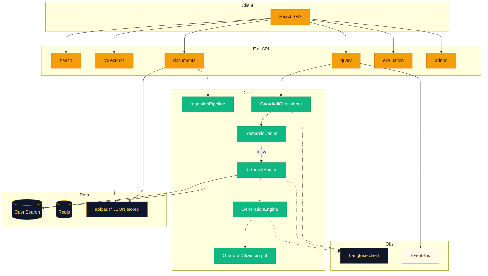
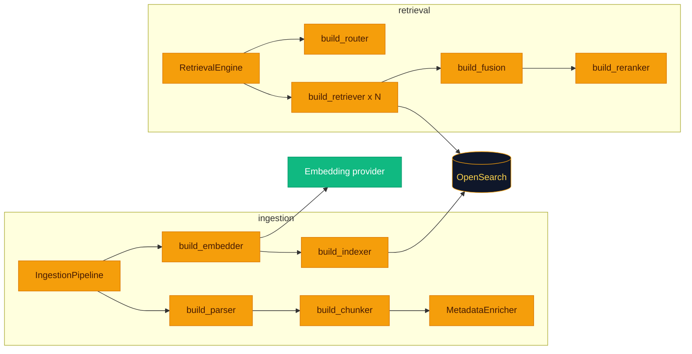
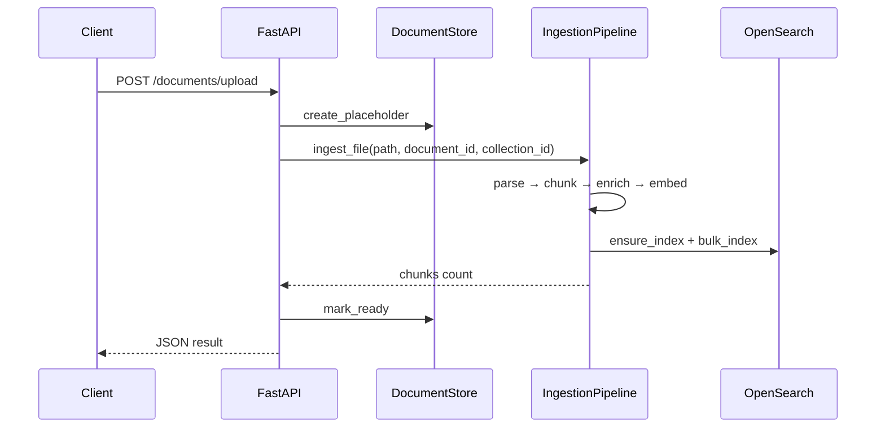
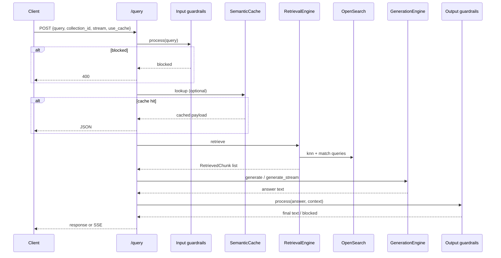

# How everything connects

If you only read one wiki page after Getting Started, make it this one: **it is the map for where your bytes go, where they get scored, and where policy intercepts them.**

---

## The system at a glance

> [!NOTE]
> **Semantic cache** sits on the query path **before** retrieval when enabled. A hit short-circuits the expensive bits—think of it as “someone already paid the embedding tax for a very similar question.”

---

## How plugins assemble (ingestion + retrieval factories)

---

## Ingestion flow (document upload)

**Why this order matters:** you cannot embed what you did not chunk, and you cannot enrich metadata you never extracted. The pipeline is deliberately linear: **parse → chunk → enrich → embed → index**.

1. **HTTP:** `POST /documents/upload` saves bytes under `uploads/{doc_id}/`, registers metadata in **`DocumentStore`**, and calls **`IngestionPipeline.ingest_file`** in a thread pool.
2. **Parser selection:** `parser` from YAML is overridden by extension: `.pdf` → `pdf`, `.docx` → `docx`, `.html`/`.htm` → `html`, `.md`/`.markdown` → `markdown`.
3. **Chunking:** `build_chunker` produces a list of text chunks. **`semantic`** chunking injects **`embed_fn`** from the pipeline so consecutive sentences are grouped by embedding cosine similarity.
4. **Enrichment:** **`MetadataEnricher`** adds `title`, `extracted_dates`, `entities` (capitalized-phrase heuristic), `enriched_at`, plus `chunk_index` / `source_file`.
5. **Embedding:** **`embed_many`** batches vectors; dimension drives index mapping.
6. **Indexing:** **`OpenSearchIndexer.ensure_index`** creates the index with **knn** settings if missing; **`bulk_index`** writes chunk documents including **`collection_id`** (default **`default`**).

> [!TIP]
> If uploads succeed but search feels empty, check **`ingestion.indexer_params.index_name`** in Dashboards—you might be staring at the wrong index.

---

## Query flow (RAG)

**The story:** publish intent, scrub input, maybe steal an answer from cache, retrieve honestly, generate with a budget, then let output policy have the last word.

1. **Event:** `EventBus.publish({"type": "query_start", ...})`.
2. **Input guardrails:** `GuardrailChain.process(query)` — may redact, warn, or block (**`HTTP 400`**).
3. **Cache:** If `use_cache` and `cache.backend == redis`, **`SemanticCache.lookup`** compares embedding cosine similarity to stored entries; on hit, returns cached payload.
4. **Retrieval:** `RetrievalEngine.retrieve` embeds the query, **routes** (`hybrid` / `rules` / `classifier`), runs configured **strategies** (e.g. dense + sparse), **fuses** lists (RRF by default), **reranks** (cross-encoder by default).
5. **Generation:** **`GenerationEngine`** builds context within token budget, calls LLM (`generate` or `generate_stream`).
6. **Output guardrails:** Process final answer; may block or attach warnings.
7. **Cache store:** Non-streaming and streaming paths can persist `{answer, ...}` keyed by semantic embedding (see [Generation](Generation.md) for streaming nuances).

> [!IMPORTANT]
> When **`generation.streaming`** is **true** and the client sends **`stream: true`**, the API still assembles the **full** answer before output guardrails and before SSE chunks go out. See [Generation](Generation.md) for why that matters for UX expectations.

---

## Application lifecycle

`main.py` **`lifespan`** constructs a single **`AppState`**: OpenSearch client, Redis async client, embedder, **`IngestionPipeline`**, **`RetrievalEngine`**, **`GenerationEngine`**, guardrail chains, **`EvaluationEngine`**, **`SemanticCache`**, **`EventBus`**, **`LangfuseTracer`**, document/collection stores. Dependencies in **`api/dependencies.py`** read from **`request.app.state.app_state`**.

---

## Related pages

- [Design Decisions](Design-Decisions.md)
- [Ingestion Pipeline](Ingestion-Pipeline.md)
- [Retrieval Engine](Retrieval-Engine.md)
- [Generation](Generation.md)
