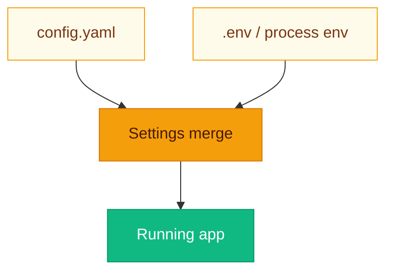

# Configuration: YAML for behavior, env for secrets

**Two layers keep prod sane:** **`config.yaml`** declares *what* the system does; **environment variables** hold *who* it talks to and *where* it lives. **`CONFIG_YAML_PATH`** points to the YAML file (default **`config.yaml`**, cwd-relative unless absolute).



---

## Full `config.yaml` reference

### `llm`

| Field | Type | Default | Description |
|-------|------|---------|-------------|
| `provider` | string | `openai` | Passed to `LLMFactory` |
| `model` | string | `gpt-4o-mini` | Chat model id |
| `temperature` | float | `0.2` | Sampling temperature |
| `max_tokens` | int | `2048` | Max completion tokens |
| `timeout_seconds` | int | `120` | Request timeout |

**Env overrides:** **`LLM_MODEL`**, **`LLM_PROVIDER`** merge over YAML at startup (**`merge_llm_from_env`**).

The checked-in profile selects OpenAI GPT-5.4 Mini for generation. Set
`OPENAI_API_KEY` locally, and remove old `LLM_PROVIDER`/`LLM_MODEL` overrides
or set them to `openai` and `gpt-5.4-mini`. To select Ollama again, set
`LLM_PROVIDER=ollama_chat` and `LLM_MODEL=qwen2.5:1.5b`. Chat provider changes
do not change local embedding or reranking. OpenAI receives the question and
selected document excerpts for generation.

### `ingestion`

| Field | Type | Description |
|-------|------|-------------|
| `parser` | string | Default parser name; overridden by file extension in pipeline |
| `chunker` | string | `fixed`, `recursive`, `semantic` |
| `embedder` | string | `openai`, `local` |
| `indexer` | string | `opensearch` |
| `parser_params` | object | Passed to parser constructor |
| `chunker_params` | object | e.g. `chunk_size`, `chunk_overlap`, `similarity_threshold` |
| `embedder_params` | object | e.g. `model`, `batch_size` |
| `indexer_params` | object | e.g. `index_name` |

### `retrieval`

| Field | Type | Description |
|-------|------|-------------|
| `router` | string | `hybrid`, `rules`, `classifier` |
| `strategies` | list | `{ name, weight, params }` items |
| `fusion` | string | `rrf`, `weighted_sum` |
| `fusion_params` | object | e.g. RRF `k` |
| `reranker` | string | `cross_encoder`, `passthrough` |
| `reranker_params` | object | e.g. `model`, `top_k` |

### `generation`

| Field | Type | Description |
|-------|------|-------------|
| `context_window_tokens` | int | Context budget (approximate) |
| `streaming` | bool | Enables SSE path in `/query` when client sets `stream: true` |
| `citation_style` | string | `bracket`, `footnote`, `none` |

### `guardrails`

| Field | Type | Description |
|-------|------|-------------|
| `input_chain` | list | `{ plugin, params }` steps |
| `output_chain` | list | Same |

### `evaluation`

| Field | Type | Description |
|-------|------|-------------|
| `metrics` | list of strings | Subset of `faithfulness`, `answer_relevance`, `context_precision`, `context_recall` |

### `cache`

| Field | Type | Description |
|-------|------|-------------|
| `backend` | string | `redis` enables semantic cache in `/query` |
| `ttl_seconds` | int | Redis TTL for cache entries |
| `similarity_threshold` | float | Min cosine similarity for cache hit |

### `observability`

| Field | Type | Description |
|-------|------|-------------|
| `langfuse_enabled` | bool | Gate Langfuse client creation |
| `tracing` | bool | Parsed from YAML (`ObservabilityConfig`); reserved for future use — runtime tracing today is driven by Langfuse keys + `langfuse_enabled` |

> [!NOTE]
> **`observability.tracing`** is a forward-looking flag; **today** Langfuse activation is really about **`langfuse_enabled`** plus keys.

---

## Environment variables

Defined in **`Settings`** (`core/config.py`), loaded from **`.env`**:

| Variable | Purpose |
|----------|---------|
| `OPENAI_API_KEY` | OpenAI API key for LLM + OpenAI embedder |
| `LLM_PROVIDER` | Overrides YAML LLM provider |
| `LLM_MODEL` | Overrides YAML LLM model |
| `OPENSEARCH_URL` | Cluster URL (e.g. `http://localhost:9200`) |
| `OPENSEARCH_USER` / `OPENSEARCH_PASSWORD` | HTTP basic auth if set |
| `REDIS_URL` | Redis connection string |
| `LANGFUSE_SECRET_KEY` / `LANGFUSE_PUBLIC_KEY` | Langfuse credentials |
| `LANGFUSE_BASE_URL` | Default `https://cloud.langfuse.com` |
| `EMBEDDING_MODEL` | Fallback embedding model, used only when `ingestion.embedder_params.model` is not set |
| `EMBEDDING_PROVIDER` | Defined but not read; the embedder is chosen by `ingestion.embedder` in YAML |
| `BACKEND_HOST` / `BACKEND_PORT` | Defined but not read by the app; set the bind address on the `uvicorn` command |
| `CONFIG_YAML_PATH` | Path to YAML |
| `CORS_ORIGINS` | Comma-separated allowed origins |
| `DEBUG` | Enables debug logging |
| `UPLOADS_DIR` | Document storage root |
| `LOGS_DIR` | Log directory |

Copy from **`env.example`** at repo root.

> [!IMPORTANT]
> Never commit **`.env`**. If you paste a key into a screenshot, rotate it—this is the voice of experience speaking.

---

## Pipeline plugin configuration

Plugins are selected **only** by string name in YAML; unknown names raise at registry resolution time.

**Strategy weights** apply during fusion (RRF multiplies reciprocal rank by weight per list).

**Example — emphasize sparse retrieval:**

```yaml
retrieval:
  router: rules
  strategies:
    - name: dense
      weight: 0.2
      params: { k: 16 }
    - name: sparse
      weight: 0.8
      params: { k: 24 }
  fusion: rrf
  fusion_params: { k: 60 }
  reranker: cross_encoder
  reranker_params:
    model: cross-encoder/ms-marco-MiniLM-L-6-v2
    top_k: 10
```

---

## Related pages

- [Getting Started](Getting-Started.md)
- [Ingestion Pipeline](Ingestion-Pipeline.md)
- [Retrieval Engine](Retrieval-Engine.md)
- [Guardrails](Guardrails.md)
