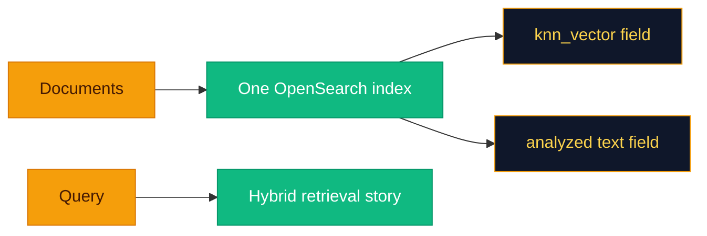

# Why the stack looks like this

This page is not a vendor bake-off—it is **the reasoning baked into this repo**. When you disagree (you will), you will at least know which assumption you are overturning.

---

## OpenSearch instead of Pinecone or Weaviate

**The bet:** enterprises often already run OpenSearch—or something close—for logs and search. Shipping a **2-node** Compose cluster here is not vanity; it is practice for HA-shaped thinking.

**What you gain in one index:** **`knn_vector`** on **`embedding`** plus **analyzed** **`text`** means dense kNN, BM25-style **`match`**, and (where supported) a **`hybrid`** query combining both—without standing up a separate “keyword engine.”

**Operational familiarity:** index templates, snapshots, and security integrations feel like **enterprise search** work, not a greenfield vector experiment.

Pinecone and Weaviate are excellent when you want managed vector DX first. This project optimizes for **self-hosted hybrid lexical + vector** on a single index and avoids splitting sparse and dense across unrelated systems.

---

## Hybrid search strategy

**Dual retrievers:** **`DenseRetriever`** uses kNN on **`embedding`**; **`SparseRetriever`** uses **`match`** on **`text`**. Weights in **`config.yaml`** scale each ranked list before fusion.

**Fusion:** Default **RRF** (`ReciprocalRankFusion`) is deliberately boring-in-a-good-way—it copes when kNN and BM25 scores live on different planets. **Weighted sum** normalizes per-list scores and adds weighted contributions when you trust your scaling story.

**Reranking:** A **cross-encoder** (`sentence_transformers.CrossEncoder`) scores **`(query, chunk)`** pairs for final ordering—precision up, latency and CPU up with it.

> [!TIP]
> If you are debugging “why did this chunk win?”, look at **strategy**, **fusion score**, then **reranker order**—three different chapters of the same mystery novel.

---

## Guardrail chain pattern

Guardrails are **ordered plugins** sharing **`GuardrailResult`** (`text`, `blocked`, `warnings`, `redacted_fields`). Actions:

- **`block`** — stop processing; API returns **`400`** with warnings.
- **`warn`** — annotate warnings; text may pass unchanged.
- **`redact`** — transform text (e.g. PII masking).

**Why chains, not one mega-plugin:** this mirrors how policy engines and DLP pipelines compose in the wild—**sequential**, **auditable**, and YAML-addressable without adopting a vendor DSL.

---

## Langfuse instead of custom tracing

**Langfuse** gives you hosted or self-hosted UI for traces, scores, and datasets. The app constructs **`Langfuse`** only when **`observability.langfuse_enabled`** is true **and** **`LANGFUSE_SECRET_KEY`** / **`LANGFUSE_PUBLIC_KEY`** are set.

**`trace_span`** (`observability/langfuse_tracer.py`) is a decorator that opens a Langfuse trace around **async** callables when a tracer is bound—extend hot paths without building a bespoke trace store on day one.

Custom OpenTelemetry-only stacks can coexist if you add exporters; this repo ships a **minimal Langfuse integration** first.

> [!WARNING]
> Core route handlers are **not** all decorated by default. If Langfuse looks empty, you probably have not wrapped the functions you care about yet.

---

## Plugin pipeline pattern

**`PluginRegistry`** maps string names to classes or factories for parsers, chunkers, embedders, indexers, routers, retrievers, fusion strategies, rerankers.

YAML selects plugins by name and passes opaque **`*_params`** dicts. New behavior arrives by **registering** a plugin and **naming** it in **`config.yaml`**—not by growing a central **`if/elif`** in **`main.py`**.

---

## Redis semantic cache

**Why Redis:** low latency, shared across API workers, TTL via **`SETEX`**.

**Mechanism:** On store, the server saves JSON **`{ embedding, value, query }`** keyed by a hash of the query string. On lookup, it **scans** keys under **`semcache:*`** and compares **cosine similarity** to the current query embedding against **`similarity_threshold`** (default **`0.92`**).

**The trade-off:** **`SCAN`** is simple but **O(n)** in cache size. High-traffic production often replaces this with vector ANN in Redis Stack or a dedicated cache index.

> [!IMPORTANT]
> Tune **`cache.similarity_threshold`** with intent: too low and you return “sort of related” answers; too high and you barely cache anything.

---

## RAGAS-style evaluation (LLM-as-judge)

**`EvaluationEngine`** implements **faithfulness**, **answer_relevance**, **context_precision**, and **context_recall** using short LLM prompts that return a single numeric score—aligned with RAGAS **concepts** without requiring the **`ragas`** Python package at runtime.

**Upside:** few dependencies, uses **your** configured model. **Downside:** scores are **judge-dependent**; calibrate prompts and models for your domain.

---

## Related pages

- [Retrieval Engine](Retrieval-Engine.md)
- [Guardrails](Guardrails.md)
- [Observability](Observability.md)
- [Evaluation](Evaluation.md)
