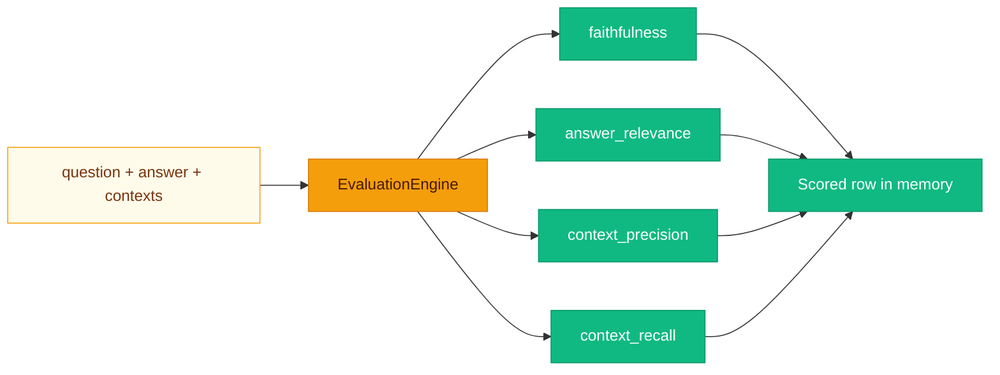

# Measuring answers without fooling yourself

**“It looks right” does not scale.** `EvaluationEngine` (`backend/app/evaluation/metrics.py`) computes **RAGAS-inspired** scores using the **configured LLM** as a numeric judge. Results are stored **in memory** in **`_results`** (restart clears history)—great for demos, less great for longitudinal benchmarks unless you persist them yourself.



---

## Configured metrics

**`evaluation.metrics`** in **`config.yaml`** selects from:

| Metric key | Method | Prompt intent |
|------------|--------|----------------|
| `faithfulness` | `faithfulness` | Do claims in the answer follow from supplied contexts? |
| `answer_relevance` | `answer_relevance` | Does the answer address the question? |
| `context_precision` | `context_precision` | Per-excerpt: is this excerpt useful for the question? (mean of up to 5) |
| `context_recall` | `context_recall` | Could the answer be fully derived from the context? |

Each metric asks the LLM for **one number** in **`[0, 1]`**; the engine parses the first float-like token via regex.

> [!WARNING]
> LLM judges drift with **model**, **temperature**, and **prompt**. Treat scores as **comparative** within a controlled setup, not absolute truth.

---

## HTTP API

### `POST /evaluation/run`

```json
{
  "question": "What is the refund policy?",
  "answer": "Refunds are available within 30 days.",
  "contexts": [
    "Our refund policy allows returns within 30 days of purchase.",
    "Shipping is free over $50."
  ]
}
```

Response includes **`id`**, **`ts`** (ISO UTC), and each computed metric key. On LLM parse failure, **`400`** with **`EvaluationError`** message.

### `GET /evaluation/results?limit=50`

Returns **`{"results": [...]}`** — most recent rows first (engine reverses tail of in-memory list).

---

## Running evaluations from the shell

```bash
curl -sS -X POST http://localhost:8000/evaluation/run \
  -H "Content-Type: application/json" \
  -d '{
    "question": "Summarize SLA",
    "answer": "99.9% monthly uptime.",
    "contexts": ["SLA: 99.9% uptime commitment per calendar month."]
  }' | python3 -m json.tool
```

---

## Custom evaluation metrics

1. Add an **`async def my_metric(self, ...)`** method on **`EvaluationEngine`** returning **`float`**.
2. In **`run_suite`**, add **`if "my_metric" in metrics: row["my_metric"] = await self.my_metric(...)`**.
3. Add **`"my_metric"`** to **`evaluation.metrics`** in YAML.

Alternatively, subclass **`EvaluationEngine`** and swap the dependency in **`main.py`** (advanced).

### Design tips

- Keep prompts **short** and ask for **one number** to simplify parsing.
- Clamp scores: **`max(0.0, min(1.0, value))`** is already applied in **`_llm_score`**.
- For production benchmarks, persist rows to PostgreSQL or your warehouse instead of **`_results`**.

> [!TIP]
> Golden datasets beat one-off curls. Start small: 20 tricky questions your users actually ask.

---

## Related pages

- [Design Decisions](Design-Decisions.md)
- [API Reference](API-Reference.md)
- [Configuration](Configuration.md)
