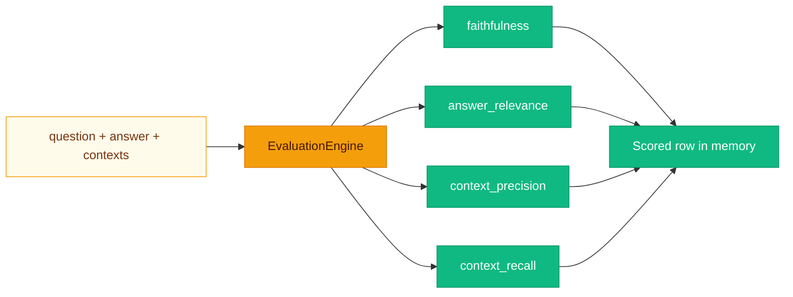

# Measuring answers without fooling yourself

**“It looks right” does not scale.** `EvaluationEngine` (`backend/app/evaluation/metrics.py`) computes **RAGAS-inspired** scores using the **configured LLM** as a numeric judge. Results are stored **in memory** in **`_results`** (restart clears history)—great for demos, less great for longitudinal benchmarks unless you persist them yourself.



---

## Prepare a SQuAD pilot (no RAGAS installation required)

From the repository root on Windows:

```powershell
.\rag-env\Scripts\python.exe backend\scripts\prepare_squad.py --download --output evaluation_data\squad-pilot
```

This explicitly downloads official SQuAD 2.0 development data once to
`evaluation_data\raw\dev-v2.0.json`; later download runs reuse the validated cache.
To use an existing original nested SQuAD JSON file instead:

```powershell
.\rag-env\Scripts\python.exe backend\scripts\prepare_squad.py --input evaluation_data\raw\dev-v2.0.json --output evaluation_data\squad-pilot-2
```

Use a new output directory each time: existing directories are never overwritten.
Download/network and input validation errors exit unsuccessfully with an explanation.
No new packages, API keys, running backend, OpenSearch or models are needed.

The script selects 20 answerable questions, 10 unanswerable candidates and ten
distinct extra passages. It spreads questions across article titles, deduplicates
shared evidence, and uses a fixed seed (42; override with `--seed`). Identical
input bytes and seed reproduce the same generated files:

- `corpus/`: Markdown passages only, with titles; these are the only files intended
  for later ingestion into an isolated evaluation collection.
- `cases.jsonl`: original question IDs, questions, source passage IDs, original
  answerability, all accepted reference answers with original character offsets,
  and review status. Offsets refer to the original passage, not the Markdown title.
- `manifest.json`: source URL/hash, seed, recipe version, selected IDs, counts,
  corpus mapping and attribution/license reference.

**Do not ingest the questions, reference answers or manifest.** They are evaluation
metadata, not searchable evidence. Downloaded/generated files under
`evaluation_data/` are excluded from Git; commit only the preparation tool, tests
and documentation. Keep outputs in that ignored directory.

SQuAD's unanswerable labels apply to individual original passages. Review all ten
`needs_review` cases against the *entire* generated corpus before treating them as
unanswerable. Even extra passages can supply answers; automated preparation does
not certify this. Answerable cases are also marked `not_reviewed` until reviewed.
This adapted subset is a pilot, not a result on the full SQuAD benchmark; familiar
public questions may also have appeared in model training.

Source: [SQuAD](https://rajpurkar.github.io/SQuAD-explorer/), Rajpurkar et al.
The [dataset card](https://huggingface.co/datasets/rajpurkar/squad_v2) identifies
[CC BY-SA 4.0](https://creativecommons.org/licenses/by-sa/4.0/); preserve attribution
and check applicable license requirements before redistributing source passages.
This step does not run the application or integrate RAGAS. A baseline runner,
judge validation and actual RAGAS metrics are subsequent work.

## Capture a reviewed baseline

The runner uses the existing local backend API. It does not install RAGAS or score
answers. Start the backend, OpenSearch, Ollama (or your configured provider) and
Redis if caching is configured. The frontend is not required.

First place your completed `review.json` beside `cases.jsonl`. It must contain
`schema_version: 1`, the SHA-256 of `cases.jsonl` in `cases_sha256`, and a `cases`
list with exactly one decision per original question ID. Each decision needs
`id`, `decision` (`include` or `exclude`) and `reason`; included cases also need
`expected_behavior`. Optional `preferred_reference` annotations preserve reference
clarifications without changing original answers. The runner joins decisions by
ID and uses included cases only.

The review is local data, not part of a Git pull. When moving the pilot to another
machine, regenerate it with the same input and seed, then copy your reviewed
`review.json` separately into the pilot folder. The runner verifies its cases
fingerprint. Never overwrite the original generated cases to make a review fit.

From the repository root:

```powershell
.\rag-env\Scripts\python.exe backend\scripts\run_squad_baseline.py --dataset evaluation_data\squad-pilot --output evaluation_data\runs\baseline-1
```

Default backend: `http://127.0.0.1:8000`; use `--base-url` to select another local
HTTP port. Remote origins and credential-bearing URLs are rejected, and proxy
environment settings are not used. The backend still uses its configured LLM
provider: inspect that configuration before running if documents must remain local.

The runner:

- Validates the reviewed cases and passage hashes before API mutations.
- Refuses an existing output folder or an existing collection named `squad-eval`,
  preventing accidental duplicate uploads during an ordinary rerun.
- Creates a fresh collection and uploads only manifest-listed Markdown passages.
  No question, reference-answer or review file is uploaded.
- Queries sequentially with `use_cache=false` and `stream=false`.
- Saves `run.json` with dataset/review fingerprints, backend YAML configuration,
  collection ID, passage-to-document mapping and progress.
- Saves `results.jsonl` with each included case/review, API response, full
  retrieved chunks, full text of source chunks selected for generation, and
  elapsed request milliseconds. `prompt_contexts` is reconstructed from matching
  source/chunk IDs, not the exact serialized LLM prompt. Timings include HTTP
  overhead and initial model warm-up; this is not a load benchmark.
- Rejects cached replies and evidence outside the newly uploaded document IDs.
- Records individual query errors, continues remaining questions and exits
  unsuccessfully if any fail. Setup/ingestion errors stop the run and record
  partial progress. There are no automatic retries or automatic deletions.

**Existing app behavior:** each successful upload clears the app's semantic cache
when Redis caching is enabled. The runner does not delete or update your existing
documents/collections, but cannot avoid that global cache-invalidation side effect
without changing the app.

After an interrupted run, inspect `run.json` and the app before retrying. An upload
may have reached the backend even if its response timed out, so do not blindly
repeat uploads. This first runner does not resume interrupted runs. Keep partial
results for diagnosis and either remove the evaluation-only documents/collection
manually, or use a new output directory and explicit fresh collection name:

```powershell
.\rag-env\Scripts\python.exe backend\scripts\run_squad_baseline.py --dataset evaluation_data\squad-pilot --output evaluation_data\runs\baseline-2 --collection-name squad-eval-2
```

Run only one importer at a time: the existing API does not enforce unique
collection names, so the duplicate check is not a concurrency lock.
Keep dataset and result directories under ignored `evaluation_data/`; responses
and configuration snapshots are local experimental data. A successful baseline
means requests completed, not that the answers were correct. Evaluate challenge
questions separately using their reviewed expected behavior.

## Configured metrics

**`evaluation.metrics`** in **`config.yaml`** selects from:

| Metric key | Method | Prompt intent |
|------------|--------|----------------|
| `faithfulness` | `faithfulness` | Do claims in the answer follow from supplied contexts? |
| `answer_relevance` | `answer_relevance` | Does the answer address the question? |
| `context_precision` | `context_precision` | Per-excerpt: is this excerpt useful for the question? (mean of up to 5) |
| `context_recall` | `context_recall` | Could the answer be fully derived from the context? |

Each metric asks the LLM for **one number** in **`[0, 1]`**; the engine parses the first float-like token via regex.

> [!WARNING]
> LLM judges drift with **model**, **temperature**, and **prompt**. Treat scores as **comparative** within a controlled setup, not absolute truth.

---

## HTTP API

### `POST /evaluation/run`

```json
{
  "question": "What is the refund policy?",
  "answer": "Refunds are available within 30 days.",
  "contexts": [
    "Our refund policy allows returns within 30 days of purchase.",
    "Shipping is free over $50."
  ]
}
```

Response includes **`id`**, **`ts`** (ISO UTC), and each computed metric key. On LLM parse failure, **`400`** with **`EvaluationError`** message.

### `GET /evaluation/results?limit=50`

Returns **`{"results": [...]}`** — most recent rows first (engine reverses tail of in-memory list).

---

## Running evaluations from the shell

```bash
curl -sS -X POST http://localhost:8000/evaluation/run \
  -H "Content-Type: application/json" \
  -d '{
    "question": "Summarize SLA",
    "answer": "99.9% monthly uptime.",
    "contexts": ["SLA: 99.9% uptime commitment per calendar month."]
  }' | python3 -m json.tool
```

---

## Custom evaluation metrics

1. Add an **`async def my_metric(self, ...)`** method on **`EvaluationEngine`** returning **`float`**.
2. In **`run_suite`**, add **`if "my_metric" in metrics: row["my_metric"] = await self.my_metric(...)`**.
3. Add **`"my_metric"`** to **`evaluation.metrics`** in YAML.

Alternatively, subclass **`EvaluationEngine`** and swap the dependency in **`main.py`** (advanced).

### Design tips

- Keep prompts **short** and ask for **one number** to simplify parsing.
- Clamp scores: **`max(0.0, min(1.0, value))`** is already applied in **`_llm_score`**.
- For production benchmarks, persist rows to PostgreSQL or your warehouse instead of **`_results`**.

> [!TIP]
> Golden datasets beat one-off curls. Start small: 20 tricky questions your users actually ask.

---

## Related pages

- [Design Decisions](Design-Decisions.md)
- [API Reference](API-Reference.md)
- [Configuration](Configuration.md)
