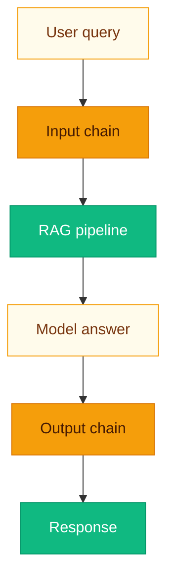

# Guardrails: policy before poetry

**LLMs are enthusiastic liars without guardrails; with bad guardrails, they are enthusiastic blockers.** This stack tries for the middle path: **ordered, inspectable steps** with explicit outcomes.

Two independent **`GuardrailChain`** instances are created in **`main.py`**: **input** (`yaml_cfg.guardrails.input_chain`) and **output** (`output_chain`). Chains run **sequentially**; the first **`blocked`** result stops the chain.



---

## Chain execution

**`GuardrailChain.process(text, context=None)`**:

1. For each **`GuardrailStepConfig`**, instantiate plugin via **`_plugin_factory(step.plugin)`**.
2. Merge **`step.params`** with internal **`_action`** from **`action`** param.
3. Await **`plugin.run(current_text, context, **params)`**.
4. Append warnings and redacted field labels; replace **`current_text`** with result text.

---

## Input chain (typical)

Runs on the **raw user query** before retrieval/cache.

### `pii_detector`

- Regexes: email, phone, SSN pattern, credit-card-like digit groups.
- **`redact`:** Substitute **`[REDACTED_EMAIL]`** style tokens.
- **`block`:** Empty text + blocked with warning naming the pattern type.
- **`warn`:** Leave text unchanged; emit warnings listing matched pattern types.

**`use_llm`** in YAML is accepted as param but **current implementation is regex-only** (no LLM call).

### `topic_filter`

- If **`allowed_topics`** is **empty**, the plugin is a **no-op** (always passes).
- Otherwise requires at least one allow-listed substring (case-insensitive) to appear in text.
- **`block`** or **`warn`** on mismatch per **`action`**.

> [!TIP]
> **`topic_filter`** is substring politics, not semantic understanding. For strict compliance, pair it with external classifiers.

---

## Output chain (typical)

Runs on the **model answer**. For hallucination checking, pass **`context`** with **`retrieval_chunks`** (list of **`{text, chunk_id, document_id}`**).

### `toxicity_filter`

- Lexical score from a small **profanity / abuse word set** vs query length.
- Compare to **`threshold`** (default **`0.85`**).
- **`block`:** empty + blocked.
- **`warn`:** pass text with warning.
- **`redact`:** replace answer with a static redacted message.

### `hallucination_checker`

- Loads **`CrossEncoder("cross-encoder/nli-deberta-v3-small")`**.
- Builds pairs using the text of up to **6** retrieval chunks and the answer with
  bracket citation markers removed. There is no 512-character slicing: the model's
  tokenizer applies its token-length limit to each pair. Long pairs can still be
  truncated by that limit.
- Uses softmax probabilities in the model's label order: contradiction,
  entailment, neutral. Takes **max** entailment probability across pairs; if below
  **`entailment_threshold`**, **`block`** or **`warn`**.
- This is a whole-answer heuristic, not sentence-level verification. Evidence
  after the first six chunks is not checked, and a high score does not certify
  every claim or citation. With no evidence or an empty answer the check skips;
  absence of a warning is not proof of grounding. Keep warning mode until
  false positives and missed failures have been evaluated on your data.

> [!WARNING]
> **`POST /query/batch`** calls **`output_g.process(res["answer"])`** **without** retrieval context—entailment checks may **skip** (no sources) unless you extend the route.

---

## Configuration example

```yaml
guardrails:
  input_chain:
    - plugin: pii_detector
      params:
        use_llm: false
        action: redact
    - plugin: topic_filter
      params:
        allowed_topics: ["billing", "product"]
        action: warn
  output_chain:
    - plugin: toxicity_filter
      params:
        threshold: 0.85
        action: block
    - plugin: hallucination_checker
      params:
        entailment_threshold: 0.35
        action: warn
```

---

## Creating a custom guardrail

1. Add a class with **`name = "my_guard"`** and **`async def run(self, text, context, **params) -> GuardrailResult`**.
2. Register in **`guardrails/chain.py`** → **`_plugin_factory`** **`mapping`** dict.
3. Reference in YAML: **`- plugin: my_guard`**.

Use **`params.get("_action", params.get("action", "warn"))`** to honor chain action.

```python
from app.guardrails.chain import GuardrailResult

class LengthCapGuardrail:
    name = "length_cap"

    async def run(self, text: str, context: dict | None, **params) -> GuardrailResult:
        max_len = int(params.get("max_chars", 4000))
        action = str(params.get("_action", "warn"))
        if len(text) <= max_len:
            return GuardrailResult(text=text)
        if action == "block":
            return GuardrailResult(text="", blocked=True, warnings=["Answer too long"])
        return GuardrailResult(text=text[:max_len], warnings=["Truncated to max_chars"])
```

---

## Related pages

- [Configuration](Configuration.md)
- [Generation](Generation.md)
- [API Reference](API-Reference.md)
