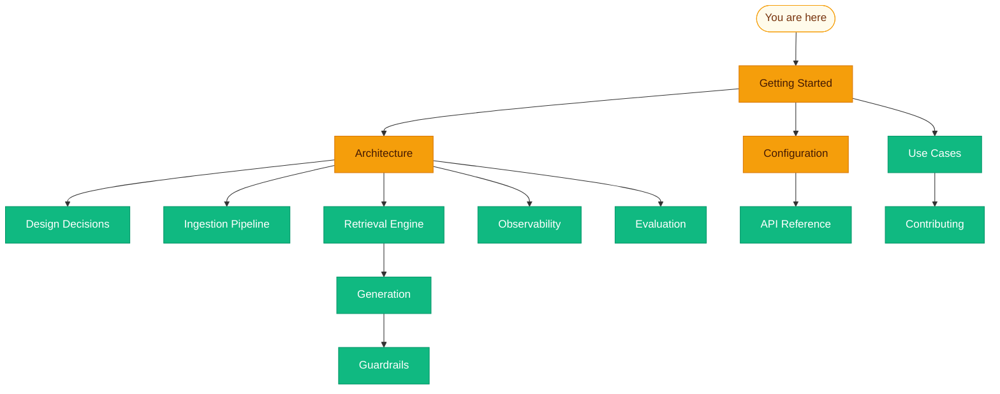

# Welcome to the wiki

You found the in-repo docs for Enterprise RAG System. The [README](../README.md) is the front door—badges, quick start, and a fast API cheat sheet. **This wiki is where the architecture, config knobs, and operational footguns get room to breathe.**

---

## What you are actually running

- **Backend:** FastAPI in `backend/app/` — ingestion, hybrid retrieval, generation, guardrails, evaluation, Redis semantic cache, Langfuse client.
- **Index:** OpenSearch with **`knn_vector`** + **`text`** mappings so dense and lexical retrieval share one honest index.
- **Frontend:** React 18 SPA (`frontend/src/`) with **ChatInterface**, **DocumentManager**, **AnalyticsDashboard**, **GuardrailsConfig**, and **EvaluationPanel**.

---

## Choose your own adventure

**New here?** Start with [Getting Started](Getting-Started.md), then skim [Architecture](Architecture.md) so the sequence diagrams stick.

**Tuning retrieval?** [Retrieval Engine](Retrieval-Engine.md) and [Configuration](Configuration.md) are your friends.

**Shipping to something resembling production?** Read [Design Decisions](Design-Decisions.md), [Guardrails](Guardrails.md), and the security notes in [API Reference](API-Reference.md).

---

## Page index

| Page | Why open it |
|------|-------------|
| [Getting Started](Getting-Started.md) | Prerequisites, install, first document, first query, Docker, troubleshooting |
| [Architecture](Architecture.md) | Diagrams, ingestion and query flows |
| [Design Decisions](Design-Decisions.md) | Why OpenSearch, hybrid fusion, guardrail chain, Langfuse, plugins, Redis cache |
| [Ingestion Pipeline](Ingestion-Pipeline.md) | Parsers, chunkers, embeddings, OpenSearch indexing, metadata, custom parsers |
| [Retrieval Engine](Retrieval-Engine.md) | Router, dense/sparse/hybrid strategies, RRF, cross-encoder reranking, custom retrievers |
| [Generation](Generation.md) | Context builder, streaming, citations |
| [Guardrails](Guardrails.md) | Input/output chains, PII, toxicity, entailment, topics, custom plugins |
| [Observability](Observability.md) | Langfuse, `trace_span`, EventBus, analytics patterns |
| [Evaluation](Evaluation.md) | RAGAS-style metrics, `/evaluation/run`, extending metrics |
| [Configuration](Configuration.md) | Full `config.yaml` reference and environment variables |
| [API Reference](API-Reference.md) | HTTP endpoints with request/response examples |
| [Use Cases](Use-Cases.md) | Four detailed scenarios with setup steps |

