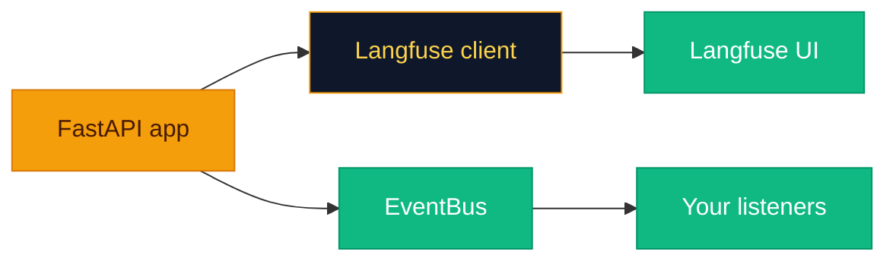

# See what the system did (and what it cost)

**You cannot improve what you cannot see.** The backend exposes two complementary mechanisms: **Langfuse** (external trace backend) and an in-process **EventBus**—telemetry for humans who like dashboards, and hooks for humans who like writing their own aggregators.



---

## Langfuse integration

**`LangfuseTracer`** (`observability/langfuse_tracer.py`):

- Reads **`observability.langfuse_enabled`** from YAML and **`LANGFUSE_SECRET_KEY`**, **`LANGFUSE_PUBLIC_KEY`**, **`LANGFUSE_BASE_URL`** from environment.
- When keys are missing, **`client`** is **`None`** and **`enabled`** is false—the app runs without remote tracing.
- On shutdown, **`lifespan`** calls **`langfuse.flush()`**.

### `trace_span` decorator

```python
from app.observability.langfuse_tracer import trace_span

@trace_span("my_operation")
async def my_operation(...):
    ...
```

When a tracer is installed via **`set_current_tracer`** in **`lifespan`**, async functions wrapped with **`@trace_span`** create a Langfuse **trace** named after the argument (or function name). Sync functions are passed through without tracing.

> [!NOTE]
> Core route handlers are **not** all decorated by default. If your traces look empty, add **`@trace_span`** to the paths you care about.

---

## Trace / span management

Langfuse traces are created per decorated invocation. For finer spans (retrieval vs generation), either:

- Nest Langfuse SDK calls using the client from **`get_current_tracer().client`**, or
- Add multiple decorated helper functions.

---

## Cost tracking

This repository does **not** ship a dedicated cost dashboard. Practical approaches:

1. **Langfuse:** Attach usage metadata in extended integrations (token counts from LLM responses if you plumb them through **`LLMProvider`**).
2. **Logs:** **`structlog`** is configured in **`core/logging.py`**—ship JSON logs to your aggregator and join on **`request_id`** if you add middleware.
3. **OpenAI usage:** Use provider billing exports or wrap **`acomplete`** / **`astream`** to record **`usage`** fields when available.

> [!TIP]
> Cost surprises usually hide in **embeddings + rerankers + repeated retrieval**—trace the full path, not just the chat completion.

---

## Query analytics

**`EventBus`** (`observability/event_bus.py`) is a minimal pub/sub. **`query.py`** publishes:

- **`{"type": "query_start", "query": "<first 200 chars>"}`**
- **`{"type": "query_cache_hit"}`** on semantic cache hit
- **`{"type": "query_done", "stream": true|false}`**

Subscribe in custom code by holding a reference to **`app.state.app_state.event_bus`** and registering async listeners (extend **`EventBus`** if you need multi-consumer patterns).

---

## Health and readiness

- **`GET /health/live`** — process up.
- **`GET /health/ready`** — OpenSearch **`ping`** and Redis **`PING`**; returns **`ready: true`** only if both succeed.

Use these for Kubernetes **liveness** vs **readiness** probes.

> [!IMPORTANT]
> **`/health/live`** tells you the Python process is breathing; **`/health/ready`** tells you the RAG stack can actually do work. Do not confuse them in prod.

---

## Related pages

- [Design Decisions](Design-Decisions.md)
- [Configuration](Configuration.md)
- [API Reference](API-Reference.md)
