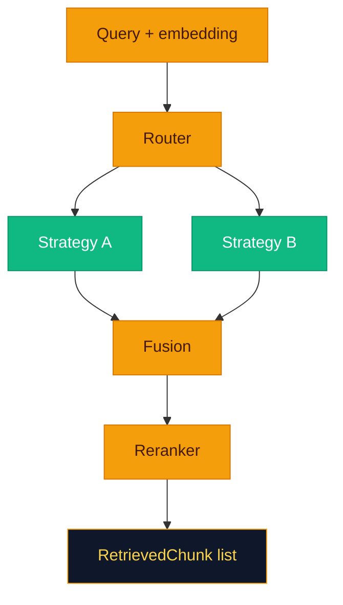

# The retrieval engine: route, retrieve, fuse, rerank

**Retrieval is where RAG earns its paycheck.** `RetrievalEngine` (`backend/app/retrieval/engine.py`) orchestrates: **embed query → route → run strategies → fuse → rerank**. If this stage is lazy, your LLM becomes an expensive summarizer of random paragraphs.



---

## Query routing

**`router.py`** — **`build_router(name, llm=...)`**.

| Router | Behavior |
|--------|----------|
| `hybrid` | Always returns **`RouteDecision.HYBRID`** — all configured strategies participate. |
| `rules` | Short queries, digit-heavy short strings, or boolean-style **`AND`**/**`OR`** → **sparse**; else **hybrid**. |
| `classifier` | LLM returns one token: **`dense`**, **`sparse`**, or **`hybrid`**. **Requires** **`LLMProvider`** passed into **`RetrievalEngine`** (wired in **`main.py`** when **`retrieval.router == "classifier"`**). |

**`select_strategies`** filters the YAML strategy list:

- **HYBRID:** full list.
- **DENSE:** strategies named **`dense`**, **`hybrid`**, or **`hybrid_strategy`**.
- **SPARSE:** strategies named **`sparse`**, **`hybrid`**, or **`hybrid_strategy`**.

If filtering empties the list, it **falls back** to the full configured list.

> [!TIP]
> **`classifier`** is powerful and slightly dangerous—your router is now a tiny LLM with opinions. Keep prompts and fallbacks boring.

---

## Dense vector search

**`DenseRetriever`** builds:

```json
{
  "size": k,
  "query": {
    "knn": {
      "embedding": {
        "vector": "<query embedding>",
        "k": k,
        "filter": { "term": { "collection_id": "<id>" } }
      }
    }
  }
}
```

**`filter`** is omitted when **`collection_id`** is null.

---

## BM25 sparse search

**`SparseRetriever`** uses:

```json
{
  "bool": {
    "must": [
      { "match": { "text": { "query": "<user query>" } } },
      { "term": { "collection_id": "<id>" } }
    ]
  }
}
```

The **`term`** on **`collection_id`** is only added when scoped.

---

## Single-request hybrid (OpenSearch hybrid query)

**`HybridRetriever`** (`hybrid_strategy`) sends:

```json
{
  "query": {
    "hybrid": {
      "queries": [
        { "match": { "text": { "query": "..." } } },
        { "knn": { "embedding": { "vector": [...], "k": k } } }
      ]
    }
  }
}
```

If the cluster rejects **`hybrid`**, **`RetrievalEngine`** catches errors for strategy name **`hybrid`** / **`hybrid_strategy`** and **falls back** to separate dense + sparse searches and concatenates hits.

> [!NOTE]
> Fallback behavior exists because not every OpenSearch deployment ages the same way—your cluster capabilities matter.

---

## RRF fusion

**`ReciprocalRankFusion`** (`fusion.py`):

- For each ranked list, score contribution is **`weight * 1/(k + rank)`** with default **`k=60`**.
- Deduplicates by **`chunk_id`** (or first 80 chars of text), keeps the best **`StrategyHit`** per id, assigns fused score.

---

## Weighted sum fusion

**`WeightedSumFusion`** normalizes each hit’s score by the **max score in its list**, then accumulates **`weight * normalized_score`** per chunk id.

---

## Cross-encoder reranking

**`CrossEncoderReranker`** loads **`sentence_transformers.CrossEncoder`** (lazy), predicts scores for **`[query, chunk_text]`** pairs, sorts descending, returns top **`top_k`** (from **`reranker_params`**, default **`8`**).

**`PassthroughReranker`** truncates to **`top_k`** without rescoring.

> [!WARNING]
> First queries after deploy can feel “cold”—cross-encoder and sentence-transformers **lazy-load** models on first use.

---

## Creating a custom retriever

1. Implement **`search(self, query, embedding, k, collection_id, **kwargs) -> list[StrategyHit]`**.
2. Register: **`@retriever_registry.register("my_retriever")`**.
3. Add a **`RetrievalStrategyItem`** with **`name: my_retriever`** in **`config.yaml`**.

Factory hook in **`strategies.build_retriever`** — add an **`if name == "my_retriever": return MyRetriever(client, index_name)`** branch or rely on **`retriever_registry.build`** for generic construction.

---

## Retrieved chunk model

**`RetrievedChunk`** fields: **`chunk_id`**, **`document_id`**, **`text`**, **`score`**, **`metadata`**, **`strategy`**.

---

## Related pages

- [Design Decisions](Design-Decisions.md)
- [Generation](Generation.md)
- [Configuration](Configuration.md)
