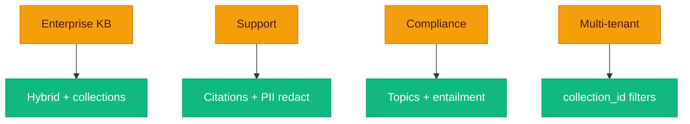

# Four stories you can actually run

**Tutorials feel fake when they skip the sharp edges.** These scenarios use the real APIs and the real **`config.yaml`** knobs—collections, hybrid retrieval, guardrails, multi-tenant filters.



---

## 1. Enterprise knowledge base Q and A

**Goal:** Employees ask natural-language questions over PDFs and Markdown internal docs.

**Steps:**

1. Run **`docker compose up -d`** or connect existing OpenSearch and Redis.
2. In **`config.yaml`**, use **`chunker: recursive`** and **`chunk_size: 512`**; set **`retrieval.router: hybrid`**.
3. Create a collection:

```bash
curl -sS -X POST http://localhost:8000/collections \
  -H "Content-Type: application/json" \
  -d '{"name":"Engineering KB","description":"Runbooks and design docs"}'
```

4. Upload documents with **`collection_id`** matching the new id.
5. Query with the same **`collection_id`** for scoped retrieval.

Hybrid retrieval covers paraphrases and exact terms; cross-encoder reranking improves context quality.

> [!TIP]
> If answers drift across teams, split collections **before** you chase fancier rerankers—bad scope is bad scope.

---

## 2. Document-grounded customer support

**Goal:** Answers cite product manuals; reduce PII in queries.

**Steps:**

1. Upload manuals via **`POST /documents/upload`**.
2. Keep default generation for bracket citations **`[1]`**, **`[2]`**.
3. Set **`pii_detector`** with **`action: redact`** on the input chain.
4. Use ChatInterface in the UI; note streaming sends tokens after full generation and output guardrails (see [Generation](Generation.md)).

Enable **`use_cache: true`** for repeated FAQs; adjust **`cache.similarity_threshold`** with care.

> [!NOTE]
> Semantic cache hits are **similarity-based**, not equality-based—tune **`similarity_threshold`** like a volume knob, not a boolean.

---

## 3. Compliance-aware document retrieval

**Goal:** Topic hints and entailment checks against retrieved sources.

**Steps:**

1. Set **`topic_filter`** **`allowed_topics`** to required substrings (non-empty list activates filtering).
2. Keep **`toxicity_filter`** and **`hallucination_checker`** on the output chain; tune **`entailment_threshold`**.
3. Use separate collections for regulated vs public content; pass **`collection_id`** on every query.
4. Optional: set Langfuse env vars and add **`@trace_span`** on handlers you want traced.

**`topic_filter`** is substring-based, not semantic; pair with external classifiers for strict compliance.

> [!WARNING]
> Substring allow-lists are easy to misunderstand—document them for your team like you would document IAM roles.

---

## 4. Multi-tenant RAG service

**Goal:** Isolate tenants via **`collection_id`** at index filter time.

**Steps:**

1. Map each tenant to a collection id from **`POST /collections`**.
2. Upload with **`collection_id`** form field per tenant.
3. Require **`collection_id`** on every **`POST /query`** from your gateway.
4. Scale API replicas with shared Redis and OpenSearch; enable real security on OpenSearch (not compose dev defaults).

Chunks use **`collection_id`** default **`"default"`** when omitted — enforce ids for tenant APIs.

> [!IMPORTANT]
> **`collection_id`** is your tenant boundary in OpenSearch filters—if your gateway lets it slip, your retrieval boundary slips with it.

---

## Related pages

- [Architecture](Architecture.md)
- [Guardrails](Guardrails.md)
- [Retrieval Engine](Retrieval-Engine.md)
